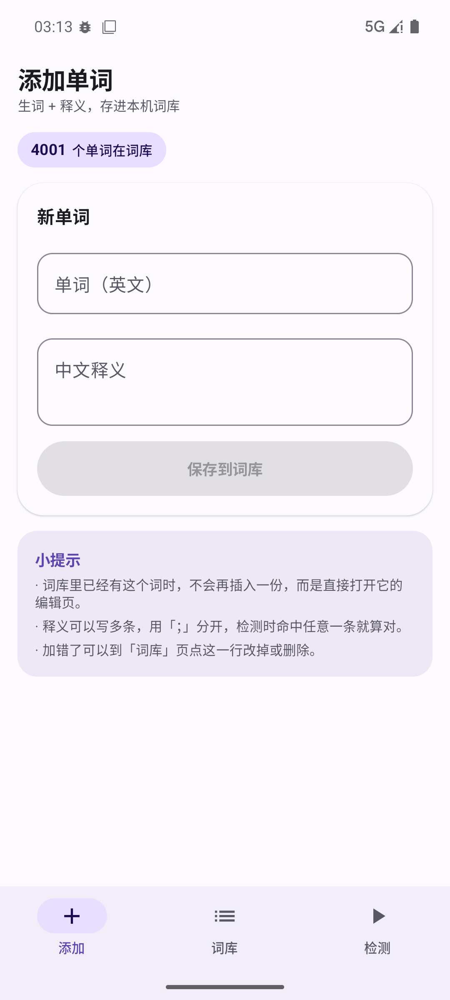
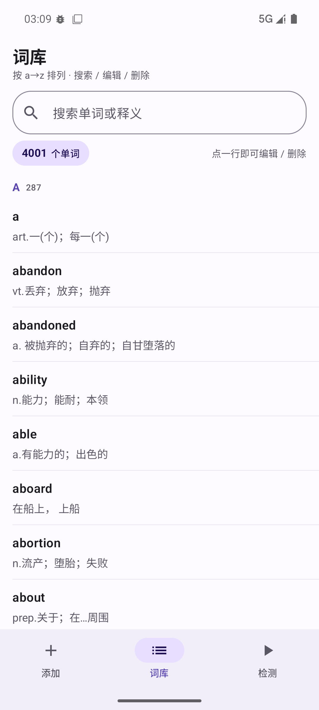
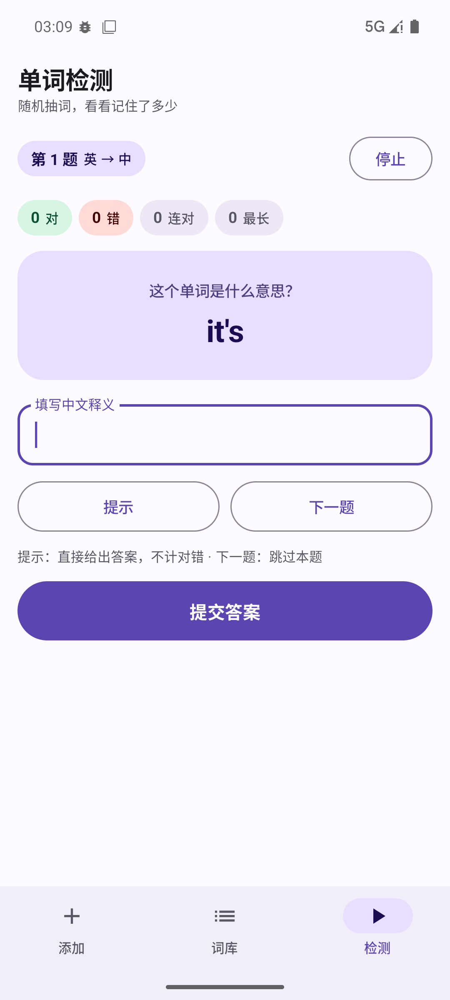
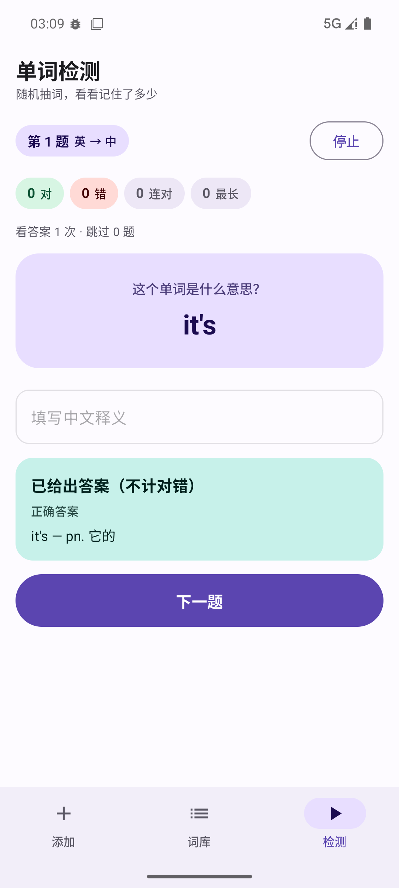
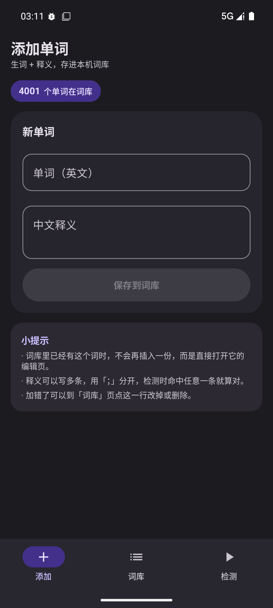

# 词汇本 VocabApp

一个只做三件事的英语单词 App：**自己加词 → 管理词库 → 抽词检测**。
Kotlin + Jetpack Compose，纯本地存储（SQLite），不联网、不要权限、无第三方 SDK。

| 添加 | 词库 | 检测 |
|---|---|---|
|  |  |  |

| 答题反馈 | 深色模式 |
|---|---|
|  |  |

- 包名 / applicationId：`com.cui.vocab`
- 最低支持 Android 7.0（minSdk 24），targetSdk 35，compileSdk 35
- 安装包：`app/build/outputs/apk/debug/app-debug.apk`（约 9.7 MB）
- 现成 APK 下载：[Releases · v1.0.0](https://github.com/Cui-chengyu/vocab-app/releases/latest)（`VocabApp-1.0.0-debug.apk`，debug 签名）

---

## 一、三个功能

### 1. 添加新单词（「添加」页）

输入英文单词 + 中文释义 → `保存到词库`。

- 单词按**小写去重**：`Apple` 和 `apple` 视为同一个词。
- **词库里已经有这个词时，不会重复插入**，而是直接弹出该词的编辑页（并提示「「xxx」已在词库中，已为你打开编辑页」）。
- 两个输入框都填了内容才能点保存；保存成功后输入框自动清空，页面底部实时显示「词库当前共 N 个单词」。

### 2. 单词记忆检测（「检测」页）

- 出题方向三选一：**英 → 中**（看单词填中文）、**中 → 英**（看中文填单词）、**随机**（每题随机）。
- 题目从整个词库里 `ORDER BY RANDOM()` 抽，同一题不会连续重复。
- 输入答案 → `提交答案`：答对是绿色卡片「答对了 🎉」，答错是红色卡片显示正确答案。
- 两个辅助按钮（答题框下面那一行）：
  - **`提示`** —— 直接把这道题的答案给出来（卡片变成绿色的「已给出答案（不计对错）」），**不计对错、不写进词库统计**，点完按钮就变成「下一题」。
  - **`下一题`** —— 不会做就直接跳过本题，同样不计对错，只累加「跳过」次数。
- 统计：对 / 错 / 连对 / 最长连对；看过答案或跳过之后会多一行「看答案 n 次 · 跳过 m 题」；**随时点「停止」**，回到设置页并显示本次成绩（「本次共答 N 题：对 x · 错 y（最长连对 z），看答案 a 次，跳过 b 题」）。
- 每题的对错次数会写回词库，在词库列表里能看到每个词的 `✔n ✘m`。
- 答案判定比较宽松：忽略大小写和标点空格；中文释义按 `；` / `,` 切开，命中其中任意一条即算对（长度 ≥ 2 时还允许包含关系）。

### 3. 词库管理（「词库」页）

- 全部单词**按 a→z 排列**，每个字母有吸顶的分组标题（A / B / C …）。
- 顶部搜索框同时搜单词和释义，实时过滤（例如搜 `ser` 既能搜到 `adviser`，也能搜到释义里含 ser 的词）。
- 点任意一行 → 弹出编辑页：可改单词、改释义、看答对答错次数、保存或删除（删除有二次确认）。

### 界面与布局

- 统一的 **Material 3** 外观：顶部栏显示「页面标题 + 一行说明」，底部三个 tab（添加 / 词库 / 检测），选中态用淡紫药丸指示。
- 主题色自定义（主色 `#5B45B0` 紫、辅助 `#00897B` 青、答对 `#1F6F43` 绿），圆角统一 10/14/18/24/30 dp，**同时支持深色模式**（深色下卡片底色自动提亮，边界不糊）。
- 三个页面都是「卡片 + 胶囊统计」的排版：
  - 添加页：顶部一个「4001 个单词在词库」胶囊，中间录入卡片（单词 / 释义 / 保存按钮），下面一张「小提示」卡。
  - 词库页：圆角搜索框 + 匹配数量胶囊，分组标题带该字母的词数（`A 287`），每行右侧显示 `✔ / ✘` 小胶囊。
  - 检测页：大数字卡展示参与词数；出题方向用胶囊单选；答题时顶栏是「第 N 题 · 英→中」+ 停止按钮，下面是 对/错/连对/最长 四个彩色统计胶囊、题目大卡、答题框、提示/下一题、彩色反馈卡。
- 公共小组件都在 `ui/Components.kt`（`StatPill` / `SelectPill` / `Caption` / `GroupBar` / `cardSurfaceColor`）。

### 预置词库

首次启动时自动从 `assets/words.tsv` 灌入 **4000 个常用词**（a–z 全覆盖，带词性和中文释义），灌完写 `meta.seeded=1`，以后不再重复灌。
数据源：`qwerty-learner` 的 `frequently_used_word01~03`（3119 个核心常用词）+ 从 `CET4_T` 里均匀抽 881 个补齐到 4000。

格式就是两列 TSV，想换词库直接替换这个文件重新打包即可：

```
abandon	vt.丢弃；放弃；抛弃
ability	n.能力；能耐；本领
```

---

## 二、代码结构

```
app/src/main/
├── assets/words.tsv                     4000 个内置词（单词 \t 释义）
├── java/com/cui/vocab/
│   ├── MainActivity.kt                  入口，enableEdgeToEdge + setContent{ VocabTheme { AppRoot() } }
│   ├── data/WordRepository.kt           原生 SQLiteOpenHelper，全部存取逻辑
│   └── ui/
│       ├── MainViewModel.kt             全部状态：词库列表、添加、编辑、检测流程
│       ├── AppRoot.kt                   三个 tab 的骨架 + 全局 Snackbar + 编辑弹窗挂载点
│       ├── AddScreen.kt                 添加页
│       ├── WordListScreen.kt            词库页（吸顶字母分组 + 搜索）
│       ├── QuizScreen.kt                检测页（设置 / 答题 / 结果反馈）
│       ├── EditWordDialog.kt            编辑 / 删除弹窗
│       ├── Components.kt                公共小组件（统计胶囊 / 选择胶囊 / 分组标题…）
│       └── Theme.kt                     Material3 主题（紫色主色 + 青色点缀，跟随系统深色模式）
└── res/
    ├── drawable/ic_launcher.xml         启动图标（紫色底 + 白色 A）
    ├── values/strings.xml               app_name = 词汇本
    └── values/themes.xml                Theme.VocabApp（Material.Light.NoActionBar）
```

数据库：`/data/data/com.cui.vocab/databases/vocab.db`

```sql
CREATE TABLE words (
    id INTEGER PRIMARY KEY AUTOINCREMENT,
    word TEXT NOT NULL,
    word_key TEXT NOT NULL UNIQUE,   -- word.trim().lowercase()，去重靠它
    translation TEXT NOT NULL,
    created_at INTEGER NOT NULL,
    right_count INTEGER NOT NULL DEFAULT 0,
    wrong_count INTEGER NOT NULL DEFAULT 0,
    last_practiced INTEGER
);
CREATE TABLE meta (k TEXT PRIMARY KEY, v TEXT NOT NULL);
```

刻意没用 Room / KSP：只有一张表，直接用 `SQLiteOpenHelper` 少一层注解处理器，增量编译也快（改一行代码 3~5 秒出包）。

---

## 三、怎么编译、怎么装

需要 JDK 17 + Android SDK（platform 35 / build-tools 35）。用 Android Studio 直接 Open 这个目录即可，
命令行则：

```powershell
# Windows
.\gradlew.bat assembleDebug
# macOS / Linux
./gradlew assembleDebug

# 产物：app/build/outputs/apk/debug/app-debug.apk
```

装到设备或模拟器：

```bash
adb install -r app/build/outputs/apk/debug/app-debug.apk
adb shell am start -n com.cui.vocab/.MainActivity
```

> `local.properties` 里的 `sdk.dir` 是本机路径，已被 `.gitignore` 忽略；首次用 Android Studio 打开会自动生成。

---

## 四、想改的时候改哪里

| 想做的事 | 改这个文件 |
|---|---|
| 换主题色 / 深色模式 | `ui/Theme.kt` |
| 换内置词库（数量、来源） | `assets/words.tsv`（格式 `单词<TAB>释义`） |
| 加「只练答错的词」「按字母筛选」等 | `data/WordRepository.kt` 加查询 + `ui/QuizScreen.kt` 加选项 |
| 改答案判定松紧 | `ui/MainViewModel.kt` 的 `normalizeAnswer()` / `matchTranslation()` |
| 加新页面 / 新 tab | `ui/AppRoot.kt` 的 `enum Tab` 和 `NavigationBar` |
| 改 App 名字 | `res/values/strings.xml` 的 `app_name` |
| 改图标 | `res/drawable/ic_launcher.xml`（矢量图，108×108 viewport） |

---

## 五、已知限制

- 只支持单机单库，没有导入导出/同步（要做可以加一个「导出为 TSV 到 Download」）。
- 检测是自由输入，不做选择题；英文答案要求拼写完全正确（除大小写和标点），中文答案允许释义部分命中。
- 没有发音（要发音得加 TTS 或塞音频资源）。
- 内置词库的中文释义直接来自开源词表，个别词条词性标注风格不统一（有的写 `a.`，有的写 `adj.`）。
